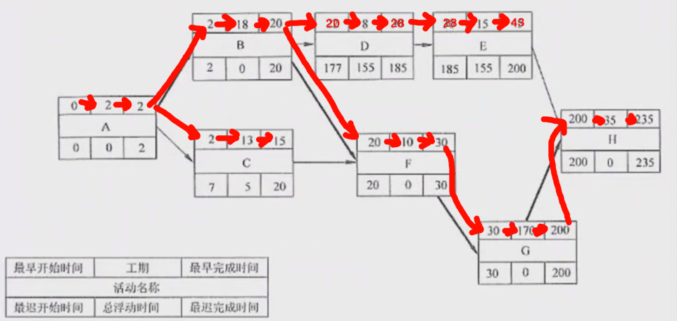
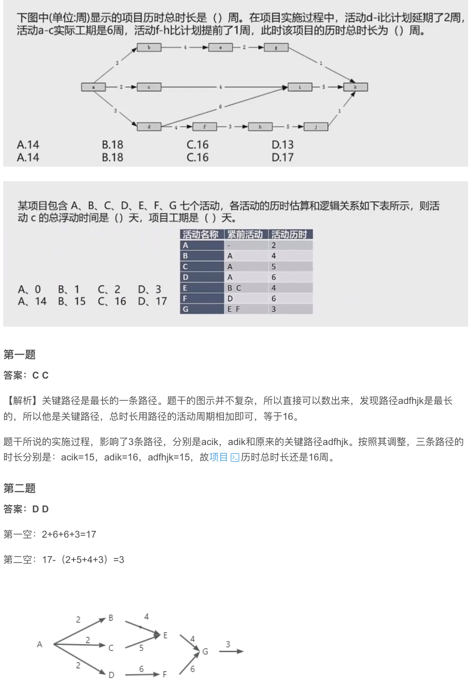

# 进度管理

逆推：取最小

配置项：GB/T11457-2006对配置项的定义为：“为配置管理设计的硬件、软件或二者的集合，在配置管理过程中作为一个单个实体来对待”。

以下内容可以作为配置项进行管理：外部交付的软件产品和数据、指定的内部软件工作产品和数据、指定的用于创建或支持软件产品的支持工具、供方/供应商提供的软件和客户提供的设备/软件。

### 配置项的状态
配置项的状态可分为“草稿”“正式”和“修改”三种。配置项刚建立时，其状态为“草稿”。配置项通过评审后，其状态变为“正式”。此后若更改配置项，则其状态变为“修改”。当配置项修改完毕并重新通过评审时，其状态又变为“正式”。

# 真题

**问题1**：质量管理的三个主要过程是什么？
**答案1**：质量策划、质量保证、质量控制。

**问题2**：质量保证和质量控制的主要区别是什么？
**答案2**：质量保证是通过系统的质量审计和过程分析来保证项目的质量，一般是在每个阶段末进行；质量控制是实时监控项目的具体结果，以判断它们是否符合相关质量标准。

## 综合题四：风险管理
某项目团队正在进行风险评估，识别到以下风险：需求变更频繁、技术难度高、团队成员经验不足。

**问题1**：风险管理包含哪六个过程？
**答案1**：风险管理计划编制、风险识别、风险定性分析、风险定量分析、风险应对计划编制、风险监控。

**问题2**：对于需求变更频繁的风险，最适合采用哪种应对策略？
**答案2**：减轻策略（如加强需求管理、建立变更控制流程）。

## 综合题五：项目管理综合
某项目经理在项目实施过程中，需要协调进度、质量、成本等多个方面的管理工作。

**问题1**：项目管理的四个主要知识领域除了进度管理、质量管理外，还包括哪些？
**答案1**：成本管理、范围管理（注：根据用户提供的上下文，这里只需要列出软件配置管理和风险管理）。

**问题2**：在项目管理中，什么是基线？它有什么作用？
**答案2**：基线是已经通过正式评审和批准的某个规约或产品，它可以作为进一步开发的基础，并且只有通过正式的变更控制流程才能被更改。基线的主要作用是确保团队成员在项目的不同阶段都有一个共同的参照标准，便于控制变更和进行沟通。

